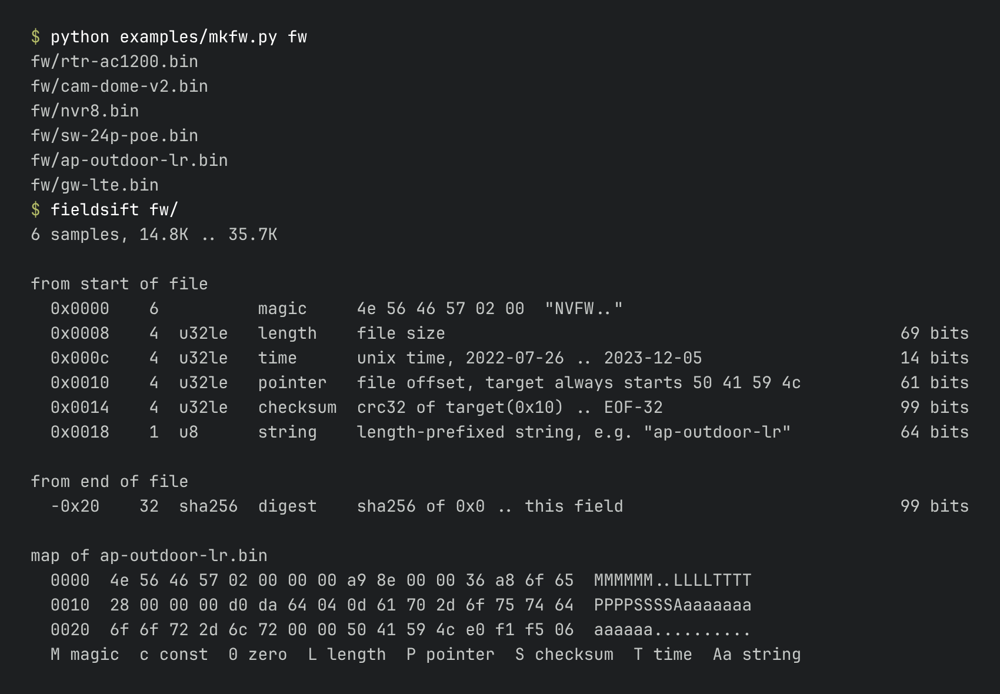
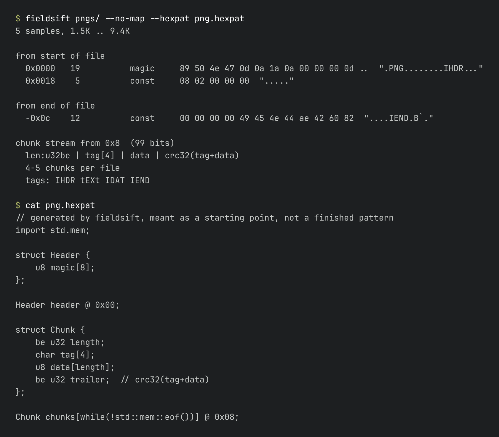

# fieldsift

Point it at a few files in a format you don't have docs for and it tells
you what the header fields are.

That's six fake firmware images (`examples/mkfw.py` makes them) and the
whole header falls out: the size field, the build time, where the payload
starts, what the CRC covers, and the sha256 stuck on the end.

## Why

The first hour with an unknown firmware image or save file always goes the
same way. Open two of them in a hex editor, flip back and forth, guess
which u32 is a length, guess what the bytes that change every time are,
then spend far too long trying CRC32 over different ranges until one
matches.

All of that is just comparing samples, so this does the comparing. It
knows no formats. It only reports relations that hold in every file you
hand it:

- bytes that never change (magic, version, padding)
- integers that follow the file size (`size`, `size - 0x20`, `size / 512`)
- integers that land on the same marker in every file even though the
  marker moves around
- checksums and digests, with the byte range they cover
- unix timestamps, length-prefixed strings
- tag/length chunk streams, the PNG / RIFF / TLV kind

It can also dump what it found as an
[ImHex](https://github.com/WerWolv/ImHex) pattern so you can carry on
from there.

Python 3.9+, standard library only.

## Install

    pip install git+https://github.com/localhostdotexe/project

Or clone and run `python -m fieldsift` from the checkout.

## Using it

    fieldsift [options] FILE [FILE ...]

Files or a directory of samples, either works.

| option | |
|---|---|
| `--head N` | bytes looked at from the start of each file (default 256) |
| `--tail N` | bytes looked at from the end (default 64) |
| `--min-bits B` | how much evidence a field needs to be shown (default 12) |
| `--hexpat FILE` | write an ImHex pattern skeleton |
| `--json` | for scripts |
| `--no-sums`, `--no-chunks` | skip the checksum / chunk search |
| `-v` | also show matches that lost to an overlapping field |

Trailers are tracked from the end of the file and show up with negative
offsets, so `-0x20` means 32 bytes before EOF.

### The crc line

Look at `0x0014` in the screenshot. The header in those images is variable
length because the board name sits in it, so the checksummed range doesn't
begin at a fixed offset and a plain "try crc32 from offset N" loop never
finds it. fieldsift spots the pointer at `0x10` first, then tries its
target as a range boundary. Result: crc32 from wherever `0x10` points, up
to the digest 32 bytes before EOF.

### Containers

Give it PNGs and it works out the chunk layout, including what the four
bytes after each chunk are:

### Picking samples

This matters more than any flag.

- 3 to 6 files is usually enough. One file works too, but then only chunk
  streams and 32 bit or wider checksums can be confirmed.
- Use files of different sizes. If they're all the same size nothing can
  be tied to the size.
- Stick to one format version. If v2 grew a header field, everything
  behind it goes blurry.

## How it decides

Each finding has a score in bits, which is roughly how unlikely it is to
be a coincidence. A u32 that equals the file size in one file means
little. The same field following the size across five files of different
sizes means a lot.

Scores get marked down for the number of things that were tried. The
checksum search runs a few thousand (algorithm, range) pairs per field,
and if you try that many ranges some 8 bit sum will match by luck. So a
one byte checksum needs at least three samples before it's shown, and a
CRC32 needs one.

When two readings overlap (u16 vs u32 at the same offset, or the same
bytes in either byte order) the higher score wins. `-v` shows the losers.

Checksums it knows: crc32, jamcrc, adler32, crc16 (xmodem, ccitt-false),
8/16/32 bit byte sums and their negated forms, xor8, sums of 32 bit
words, md5, sha1, sha256.

Ranges can start at 0, a few fixed offsets, right after the field, or a
pointer target. They can end at EOF, a few bytes short of it, at the
field, or at a pointer target. If the range includes the field itself it
is tried with the field zeroed and with it cut out.

## What it won't do

- It only looks near the start and end of the file. A field sitting
  behind variable length data is found only if a chunk stream leads there.
- No CRC parameter brute force. A custom polynomial gets you nothing
  here. [delsum](https://github.com/8051Enthusiast/delsum) and CRC RevEng
  do that, and they go a lot faster once you know which field and roughly
  which range.
- Compressed or encrypted files show their outer header and that's it.
- A chunk stream has to run exactly to EOF. Stream plus trailer isn't
  recognised yet.
- Timestamps need around six samples with different times at the default
  threshold. Drop `--min-bits` if you have fewer.
- The checksum search takes about a second per MB of the smallest sample.
  For big images try `--no-sums` first or trim the files.
- The ImHex output is a skeleton. You will be renaming things.

## Similar tools

[Netzob](https://github.com/netzob/netzob) and the BinaryInferno paper
(NDSS 2023) do this kind of inference for captured network messages.
fieldsift is for files: it works from both ends, pins checksums to an
exact byte range, follows pointers, and hands over to a hex editor.

## Tests

    python -m unittest

## License

MIT
